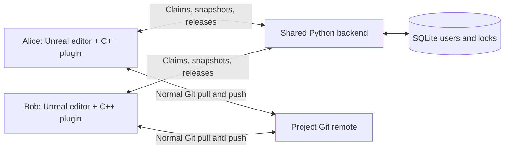

# Git Soft Lock complete guide

Git Soft Lock helps a team avoid overwriting the same Unreal asset while using Git. When an enrolled editor changes an asset, it asks a shared backend to reserve that file for the current person and checkout. Other people can experiment with it in memory, but their protected editor cannot save it while someone else owns the lock.

The system has a **C++ Unreal editor plugin** and a **Python backend with SQLite**. It does not require Node.js, Docker, or Python packages from pip. Git still stores and transfers the project; the backend stores ownership information.

This guide describes plugin **0.1.0**, protocol **1**, and the current implementation reviewed on **27 October 2026**. The editor validation target is **Unreal Engine 5.8 on Windows**.

## Contents

- [Features at a glance](#features-at-a-glance)
- [How the parts connect](#how-the-parts-connect)
- [What identifies a lock](#what-identifies-a-lock)
- [The complete editing workflow](#the-complete-editing-workflow)
- [Notifications and their buttons](#notifications-and-their-buttons)
- [How saving is protected](#how-saving-is-protected)
- [When locks are released](#when-locks-are-released)
- [Connection updates and timing](#connection-updates-and-timing)
- [Installation and first local setup](#installation-and-first-local-setup)
- [Hosting on Ubuntu inside Termux](#hosting-on-ubuntu-inside-termux)
- [Settings and private files](#settings-and-private-files)
- [Daily team workflow](#daily-team-workflow)
- [Git and Git LFS integration](#git-and-git-lfs-integration)
- [Backend administration](#backend-administration)
- [Troubleshooting](#troubleshooting)
- [Coverage and current limitations](#coverage-and-current-limitations)
- [Testing the system](#testing-the-system)
- [Technical references](#technical-references)

## Features at a glance

| Feature | Current behavior |
| --- | --- |
| Automatic acquisition | Claims a file when Unreal reports a package modification or dirty state. Opening an asset alone does not reserve it. |
| Named ownership | Conflict notices show the display name attached to the authenticated backend user. |
| Testing mode | Allows unsaved experiments on another person's asset without granting permission to write it. |
| Save protection | Checks server ownership before protected package writes and rejects conflicting or unverifiable saves. |
| Autosave protection | Checks the source asset even when the autosave destination is under `Saved`. |
| Save As protection | Checks original and destination paths, so another filename cannot bypass the source lock. |
| Editor delete and move checks | Checks supported editor delete, rename and move predicates before proceeding. |
| Local revert | Reloads the selected package from local disk, discarding its unsaved memory changes. |
| Lock dashboard | **Tools > Git Soft Lock** shows connection, repository, server, asset paths, names and presence. |
| Automatic release | Releases eligible files after they are clean and match the configured Git upstream. |
| Persistent ownership | Closing Unreal, losing connectivity or restarting the backend retains locks. |
| Stale file detection | Rejects a new claim if its starting file differs from the last released fingerprint. |
| Checkout identity | Distinguishes two clones even when the same person uses both. |
| Optional Git guard | Checks ownership of staged Unreal files before commit, preserving compatible existing hooks. |
| User administration | Creates, rotates and disables credentials; restricts users to specified repository IDs. |
| Backup and recovery | Creates consistent SQLite backups and supports explicit, generation-checked administrative recovery. |
| Simple hosting | Runs directly on Windows or in Ubuntu inside Termux; supports localhost, SSH forwarding and HTTPS. |

## How the parts connect

Every teammate connects to **one authoritative backend for the project**. Artists do not each run an independent ownership database. The backend does not need the Unreal project, GitHub credentials, Git, or Unreal Engine installed.



The two communication paths serve different purposes. The backend answers **who may save a file**. Git transfers the actual asset changes. Receiving a lock update never downloads an asset or updates an already-loaded object in Unreal.

For local testing, the backend runs on the same PC as the editor. For phone hosting, it runs inside Ubuntu in Termux. Each PC can open an SSH tunnel to that phone and keep the plugin URL as `http://127.0.0.1:8791`.

The independent repository contains two component folders:

```text
GitSoftLock/
  README.md
  Plugin/
    GitSoftLock.uplugin
    Source/                 Native editor module and automation tests
    Tools/                  Enrollment, optional Git validation, test runners
    Hooks/                  Optional pre-commit template
    Docs/                   This guide and the implementation plan
  Backend/
    server.py               HTTP/TLS service and administrative CLI
    config.example.json     Configuration template
    start.sh                Ubuntu/Termux launcher
    start.ps1               Windows launcher
    test_backend.py         Backend tests
    API.md                  Protocol and storage reference
```

## What identifies a lock

| Term | Meaning | Example |
| --- | --- | --- |
| Repository ID | A shared logical project identifier chosen by the administrator. It is not a local folder name or a GitHub login. | `raymond-project` |
| Asset path | File path relative to the consuming project's Git root. | `Content/Materials/M_Wall.uasset` |
| User ID | Stable backend account identifier. | `alice` |
| Display name | Name shown to teammates. | `Alice` |
| Workspace ID | Private identifier for one local checkout. Enrollment generates or reuses it. | A generated UUID |
| Generation | Random identifier for a particular lock acquisition, used to reject outdated release requests. | Generated by the backend |
| Fingerprint | MD5 of file bytes, or `missing` when no file exists. Used for content equality, not authentication. | A 32-character hexadecimal value |

There is one owner for each **repository ID + normalized asset path**. Paths use forward slashes and case-insensitive keys. Avoid case-only duplicate asset names.

Ownership requires both the user and workspace to match. Alice's second clone does not automatically own a lock taken by her first clone. Do not copy `Saved/GitSoftLock` between checkouts or machines.

Use the same repository ID on every clone and branch of one project. Locks are shared across those branches. A different ID would create a separate ownership namespace and defeat coordination for the same files. Distinct projects should have distinct IDs.

## The complete editing workflow

Suppose Alice and Bob both have the current `M_Wall.uasset`.

1. **Alice changes the material.** Unreal reports the modification. The plugin determines its repository-relative path and starting content fingerprint, then submits a claim.
2. **The backend chooses the owner atomically.** A SQLite transaction either creates Alice's lock, confirms her existing ownership, or reports a conflict. If two people claim together, only one can acquire the path.
3. **Bob's shared lock list updates.** His next successful snapshot shows Alice as owner. The usual polling interval is two seconds while the editor is ticking.
4. **Bob tries changing the material.** His editor reports that the file is locked by Alice. Bob can keep testing in memory or revert. Modification detection is a warning after Unreal reports a change; it is not a block on clicking every property.
5. **Bob tries to save.** The save predicate requests authoritative permission. Alice still owns the file, so Unreal's protected package write is rejected. Bob's unsaved changes remain in memory until he discards them or a later save becomes authorized.
6. **Alice saves.** Her editor confirms ownership and writes her file. The lock stays with her while her work has not been published.
7. **Alice commits and pushes normally.** The plugin later verifies that the package is no longer dirty, the file/index is clean, and its content matches the configured upstream. It releases ownership and records the published fingerprint.
8. **Bob pulls and reloads.** His file must match the released fingerprint before a new claim succeeds. With current content and no other owner, Bob can acquire the lock and save his own changes.

```mermaid
sequenceDiagram
    participant A as Alice editor
    participant S as Lock backend
    participant B as Bob editor
    A->>S: Claim file with starting fingerprint
    S-->>A: Acquired for Alice workspace
    B->>S: Snapshot
    S-->>B: Alice owns the file
    B->>S: Claim during edit or save
    S-->>B: Denied, locked by Alice
    Note over B: Testing may stay in memory; save is blocked
    A->>S: Claim again before saving
    S-->>A: Existing owner confirmed
    Note over A: Save, commit, push, and verify clean upstream content
    A->>S: Release with generation and published fingerprint
    S-->>A: Released
    Note over B: Pull and reload the published asset
    B->>S: Claim with matching fingerprint
    S-->>B: Acquired for Bob workspace
```

## Notifications and their buttons

### When editing a locked file

The notice contains the file path, **This file is locked by Alice**, and an explanation that testing changes may remain in memory but saving requires ownership.

| Button | Effect |
| --- | --- |
| **I know, just doing testing** | Dismisses the notice and suppresses repeated edit warnings for that path in this editor session. It does not change server ownership or authorize saving. |
| **Revert** | Attempts to discard this package's unsaved changes and reload its current local disk version. |

The testing acknowledgement is held in editor memory. Successful plugin revert clears it; restarting Unreal also starts a new session. A later save still checks ownership even if edit warnings have been acknowledged.

### When saving a locked file

The notice contains the owner and **Save blocked. No package was written.** The conflicting write has already been rejected before the buttons are displayed.

| Button | Effect |
| --- | --- |
| **Don't save** | Dismisses the notice and leaves unsaved changes in memory. |
| **Revert changes** | Attempts to discard the package's unsaved changes and reload its local disk version. |

Neither button permits the rejected write. If the package becomes available later, a new save can succeed only after normal server authorization and content checks.

### When ownership cannot be verified

An unavailable service, invalid credentials or a file changed on disk produces an ownership-verification message instead of inventing an owner's name. A stale-content reply asks the user to pull and reload. When protection is enabled, these conditions reject the save.

### What Revert actually does

Revert reloads the existing **local disk file** into Unreal. It does not run `git restore`, reset a commit, fetch a teammate's work, or overwrite existing disk changes. Previously saved local changes remain on disk.

Revert is refused if there is no disk version, if Play In Editor is running, or if reloading a map would discard another dirty package. A never-saved package needs manual discard. For a map, save or intentionally discard other dirty packages first. Stop PIE before retrying.

## How saving is protected

The plugin participates in Unreal's `IsPackageOKToSaveDelegate` and preserves the predicate that was installed before it. If the previous predicate rejects a save, Git Soft Lock does not override that rejection.

For a protected write, the plugin checks the original path, current package path, and any relevant destination path. It submits a fresh claim and requires a successful response identifying the current workspace as owner. A cached dashboard entry is never enough to permit a write. Saves from a worker thread are denied rather than bypassing the game-thread checks.

| Save operation | Ownership checked |
| --- | --- |
| Normal Save | The protected package path. |
| Save All | Each affected package separately. This is not an all-or-nothing transaction across the selection. |
| Autosave | The original project asset, even when the backup destination is under `Saved`. |
| Save As | The original asset and any protected destination path. |
| Supported editor rename/move | Source and resolved destination paths, followed by save checks where applicable. |
| Supported editor deletion | Ownership is checked through Unreal's delete predicate. |

An owned package may save while another package in Save All is rejected. A denied write does not silently discard the rejected package's memory changes.

After a network failure, the plugin briefly reuses **denial** for two seconds to avoid waiting through a full timeout for every package in Save All. It never reuses a successful authorization to skip a future save check. A successful snapshot clears this denial delay.

## When locks are released

Saving, closing an asset tab, exiting Unreal, or waiting for a timeout does **not** release a lock.

With automatic release enabled, the editor checks owned assets approximately every 20 seconds. A candidate must satisfy all of the following:

- The package has no unsaved changes.
- The file has no worktree or index changes, including an untracked file or an uncommitted deletion.
- The current branch has a configured upstream tracking ref.
- Git reports that this path matches that upstream ref.
- The package and file remain unchanged when the asynchronous Git checks finish.
- The backend still recognizes this workspace and the current acquisition generation.

The editor considers up to eight candidates per pass. A large or ineligible lock set can delay other files; 20 seconds is a scheduling interval, not a release guarantee. Check the dashboard before handing a file to someone else.

Release also applies to abandoned experiments when their package is clean and their disk file already matches upstream. A saved local-only commit retains the lock when its content differs from upstream. An unrelated unpushed change elsewhere does not prevent an otherwise eligible file from releasing.

The plugin reads **local remote-tracking refs**. It does not fetch, verify the remote hosting service live, or push for you. Maintain the correct upstream and normal Git synchronization. The backend trusts the owner's release fingerprint and does not independently inspect Git.

After release, the backend remembers the final fingerprint. A future claimant with different bytes is denied as stale. This check exists only after a release or administrative recovery has established a published fingerprint; a brand-new path has no previous published baseline.

## Connection updates and timing

This implementation uses HTTP request/response polling, not WebSockets or server push. A teammate's ownership notice appears when they edit or try to save; merely receiving a lock-list update does not create a conflict popup.

| Operation | Default timing | Configurable in project settings |
| --- | --- | --- |
| Snapshot and ownership heartbeat | Every 2 seconds while Unreal ticks; overlapping polls are avoided. | No |
| Fallback dirty-package scan | Every 5 seconds. | No |
| Automatic release scheduling | Every 20 seconds, with a background Git check. | Enable/disable only |
| Backend online indicator | Last activity less than 30 seconds ago. | No |
| Editor HTTP request timeout | 3 seconds, clamped to 1–10 seconds. | Yes |
| Temporary save-denial delay after failure | 2 seconds. | No |
| Python enrollment/client HTTP timeout | 5 seconds. | No |

Heartbeats refresh presence for the requesting user's workspace. **Offline is a presence label, not an expiration policy.** An offline owner's lock stays authoritative.

Editor stalls, slow networks and Git work can extend observed timings. Save authorization is synchronous, so the editor can briefly pause while awaiting a reply. Large asset hashing also takes local disk/CPU time. No supported team-size or latency benchmark is currently published.

## Installation and first local setup

### Requirements and component placement

| Location | Requirements |
| --- | --- |
| Editing Windows PC | UE 5.8 C++ build toolchain, Git, the C++ plugin, Python 3.12+ for the supplied client tools. Git LFS if the project uses it. |
| Backend host | Python 3.10+ with standard `sqlite3` and `ssl`; a persistent writable private directory. |
| Ubuntu in Termux | The existing Ubuntu environment, Python, and a session kept running. SSH forwarding additionally uses native Termux OpenSSH. |

Install the contents of `Plugin/` as `YourProject/Plugins/GitSoftLock/`, with `GitSoftLock.uplugin` directly inside that directory. Alternatively, put the entire repository there: Unreal recursively discovers `Plugin/GitSoftLock.uplugin`. Keep only one installed descriptor and rebuild the project's editor after installing or updating native code.

Commands below run from the **GitSoftLock repository root**. When only the plugin contents are installed, use `Tools/client.py` from that plugin directory in place of `Plugin/Tools/client.py`.

### Start the local backend

```powershell
python Backend/server.py init --repo local-demo --id alice --name "Alice"
python Backend/server.py serve
```

Leave that terminal running. In a second terminal:

```powershell
python Backend/server.py status
python Backend/server.py add-user --repo local-demo --id bob --name "Bob"
```

The service listens at `http://127.0.0.1:8791`. The first setup creates `Backend/config.json`, its database, and Alice's private credential file. Bob receives a separate credential file. Repeating the same `init` preserves existing matching credentials; `add-user` refuses to silently replace an existing account.

If Python is not on PATH, invoke your installed Python executable by its full path. The Windows launcher also accepts `Backend/start.ps1 -PythonExecutable C:/Path/To/python.exe`.

### Enroll the consuming project

Close that project's editor, then run:

```powershell
python Plugin/Tools/client.py --project D:/UnrealProjects/YourProject configure --url http://127.0.0.1:8791 --repo local-demo --credential-file Backend/credentials/alice.json --enable-project --install-hook
```

Replace the project path with the folder containing the project's `.uproject`. It must be in the intended Git checkout. `--project` identifies the **consuming Unreal project**, not the independent GitSoftLock repository.

The command verifies credentials with the backend, writes private workspace settings, enables shared editor protection with `--enable-project`, and optionally installs the Git guard with `--install-hook`. Open the rebuilt editor and check **Tools > Git Soft Lock** for a connected state.

Share the plugin/submodule reference and the Git Soft Lock section of `Config/DefaultEditor.ini` through the project repository. Each teammate enrolls their own clone with their own credentials. They may omit `--enable-project` once the shared configuration is present. Never share `Saved/GitSoftLock`.

For two editors on one PC, use two separate project checkouts and enroll them separately. To test from another PC, that PC needs a tunnel or HTTPS access to the same backend; its own localhost address does not point at the first computer.

## Hosting on Ubuntu inside Termux

Open the Ubuntu environment already installed on the phone. Inside Ubuntu, install Python if needed, copy the `Backend` folder into private Ubuntu storage, and start it:

```sh
apt update
apt install -y python3 ca-certificates
cd ~/GitSoftLock/Backend
python3 server.py init --repo your-project --id alice --name "Alice"
sh start.sh
```

Use the Ubuntu root session or prefix apt commands with `sudo` as appropriate. The example assumes the folder has already been copied to `~/GitSoftLock/Backend`. A fresh initialization creates a new service; preserving an existing service instead requires transferring its consistent database backup and configuration with all clients stopped.

Keep this Ubuntu session open. This setup runs a foreground Python process because PRoot does not provide a normal systemd/init environment. [PRoot limitations](https://github.com/termux/proot-distro#limitations)

For the initial same-network connection, open a separate **native Termux** session outside Ubuntu:

```sh
pkg install openssh
passwd
whoami
sshd
```

Use an existing SSH key setup if preferred. Find the phone's Wi-Fi IP in Android settings. From Windows, replace `TERMUX_USER` and `PHONE_IP`, and ensure no local test backend is already occupying port 8791:

```powershell
ssh -N -o ExitOnForwardFailure=yes -o ServerAliveInterval=30 -o ServerAliveCountMax=3 -L 127.0.0.1:8791:127.0.0.1:8791 -p 8022 TERMUX_USER@PHONE_IP
```

Keep that tunnel open. Enroll the PC against `http://127.0.0.1:8791`, using the repository ID and credentials from the phone. Each PC's tunnel reaches the same phone database. Termux normally uses SSH port 8022 and supports password or public-key authentication. [Termux SSH guidance](https://github.com/termux/termux-packages/discussions/18318)

Give phone shell access only to trusted people; it is separate from a Git Soft Lock user token. Remote teammates outside the LAN need a reachable private network or secure SSH route first. The backend does not create a VPN, public endpoint, or automatic router configuration. Direct HTTPS is also supported with a trusted certificate; see [backend hosting details](../../Backend/README.md#configuration).

Keep the phone powered and connected. Android may kill Termux processes. Restarting the backend with the same database preserves locks; editor saves remain blocked during the outage. This device behavior needs testing on your actual phone. [Termux process limitations](https://github.com/termux/termux-app#installation)

## Settings and private files

### Unreal project settings

Open **Project Settings > Plugins > Git Soft Lock**. These values are read at startup; restart Unreal after changing them.

| Setting | INI key | Default | Purpose |
| --- | --- | --- | --- |
| Enabled | `bEnabled` | `False` | Enables ownership enforcement for the project. |
| Server URL | `ServerUrl` | Empty | Backend origin, such as `http://127.0.0.1:8791`. |
| Repository ID | `RepositoryId` | Empty | Shared identity authorized by the backend administrator. |
| Request timeout seconds | `RequestTimeoutSeconds` | `3.0` | Editor HTTP timeout, clamped to 1–10 seconds. |
| Git executable | `GitExecutable` | `git` | Git executable on PATH or an absolute path. |
| Auto release published files | `bAutoReleasePublishedFiles` | `True` | Enables the clean/upstream release checks. |

Example shared `Config/DefaultEditor.ini` section:

```ini
[/Script/GitSoftLockEditor.GitSoftLockSettings]
bEnabled=True
ServerUrl="http://127.0.0.1:8791"
RepositoryId="local-demo"
RequestTimeoutSeconds=3.0
GitExecutable="git"
bAutoReleasePublishedFiles=True
```

The plugin descriptor being enabled is different from enforcement being enabled. A fresh installation loads the plugin but leaves `bEnabled=False`, showing an onboarding warning. Once `bEnabled=True`, missing credentials, a missing Git root, or an unavailable backend blocks protected saves.

Disabling automatic release keeps owned files locked after publication. There is no manual unlock button in the current dashboard; use automatic release in the normal workflow and reserve administrator recovery for exceptional cases.

### Backend configuration

`Backend/config.json` defaults to loopback port 8791 with `data/locks.sqlite3`. It supports `bind`, `port`, `database`, `certfile`, and `keyfile`. Paths in the JSON are relative to the configuration file. Plain HTTP is restricted to loopback; direct remote binding requires TLS.

Global `--config` and `--db` options go **before** the subcommand. `GIT_SOFT_LOCK_CONFIG` and `GIT_SOFT_LOCK_DB` can provide defaults. Ensure administrative commands point at the same database as the running server. [Complete backend configuration](../../Backend/README.md#configuration)

### Where information is stored

| Location | Contents | Share in Git |
| --- | --- | --- |
| Project `Config/DefaultEditor.ini` | Shared policy, server URL and repository ID. | Yes, after selecting the team's configuration. |
| Project `Saved/GitSoftLock/client.json` | Personal bearer token and workspace ID. | No |
| Project `Saved/GitSoftLock/workspace.txt` | Local checkout identity. | No |
| Project `Saved/GitSoftLock/editor.guard` | Open handle used to detect a second protected editor in the same checkout. | No |
| Project local Git config | `softlock.enabled`, Python/client/project paths. No token. | No |
| Backend `config.json` | This installation's storage/listening configuration. | Ignored; manage privately. |
| Backend `data/locks.sqlite3` | Users, active locks, published fingerprints and audit events. | No |
| Backend `credentials/*.json` | Exported raw tokens for enrollment. | No |
| Backend `backups/` | Consistent database snapshots. | No; copy to private backup storage. |

Ensure the consuming project's `.gitignore` excludes `Saved/`. Linux credential exports use restrictive file creation permissions; Windows users should also restrict the folder ACL. The database contains token hashes, while enrollment files contain usable tokens.

## Daily team workflow

Before editing, connect to the shared backend, synchronize your Git checkout, reload any externally changed assets, and check the lock dashboard. Keep your clone's upstream configured correctly.

While editing, work normally. When a conflict appears, choose whether to discard the local experiment or keep it in memory. Coordinate with the named owner if their asset is needed. Testing is not a way to publish changes to a locked source asset.

When publishing, save your owned files, commit and push with your normal Git client, then keep Unreal open until the dashboard shows release. Tell the next person to pull and reload. If you exit immediately after pushing, the persistent lock may remain until you reopen the same workspace and the release check runs.

If the backend disconnects, existing unsaved changes stay in memory, but protected saves cannot proceed. Restore connectivity before depending on disk saves. Closing Unreal can lose those unsaved experiments; the backend does not store their contents.

Switch branches only after deliberately handling local changes and ownership. The same path shares one lock across branches, and a branch with content different from the last published fingerprint may be rejected. The system has no branch-specific ownership or merge resolution UI.

## Git and Git LFS integration

Git Soft Lock uses normal Git commands to find the root and inspect publication state. It does not replace Git, Git LFS, or the editor's chosen source-control provider. Its backend has no Git-host integration and never receives asset files.

The optional pre-commit guard checks every staged `.uasset`/`.umap` path against a fresh snapshot. Both the old and new path of a rename are checked. A missing lock or someone else's lock blocks the commit; staged non-Unreal files do not require these locks. The guard does not acquire ownership itself.

Installation inserts a marked block into the active shell pre-commit hook, preserving existing LFS/custom logic and `core.hooksPath`. A non-shell hook is left unchanged and must be chained manually. After moving the plugin/tools, refresh the stored client path:

```powershell
python Plugin/Tools/client.py --project D:/UnrealProjects/YourProject install-hook
```

This hook is cooperative and can be bypassed, like other client-side Git hooks. It is not a pre-push hook or enforcement on the Git hosting server. Turning it off does not turn off Unreal save protection, and turning off Unreal protection does not automatically remove the hook.

Git LFS remains responsible for transferring large asset data. Git Soft Lock maintains its own ownership records and does not call the Git LFS locking API. Wait for normal push/LFS upload success before handing work over. Project plugin content stored in a separate nested Git repository or submodule needs particular care: the current editor module resolves one consuming Git root, so automatic publication checks for another repository are not a supported multi-repository workflow.

## Backend administration

All commands in this section run from the **GitSoftLock repository root on Windows**. In Ubuntu from the `Backend` directory, replace `python Backend/server.py` with `python3 server.py`.

| Task | Command |
| --- | --- |
| Initialize first account | `python Backend/server.py init --repo your-project --id alice --name "Alice"` |
| Start the server | `python Backend/server.py serve` |
| Check service and database health | `python Backend/server.py status` |
| Add a teammate | `python Backend/server.py add-user --repo your-project --id bob --name "Bob"` |
| Show all stored locks | `python Backend/server.py list-locks` |
| Create a consistent backup | `python Backend/server.py backup` |
| Disable a token | `python Backend/server.py disable-user --id bob` |

Press Ctrl+C in the foreground server terminal to stop it. Restart using the same configuration/database. There is no automatic boot service or scheduled backup job installed by these commands.

### User identity and credential changes

Display names come from the server user record, not Git's `user.name`. Give each teammate an individual token and only the repository IDs they need. Repeat `--repo` to authorize multiple projects.

To rotate a token, or change the name/repository list through the supplied CLI, explicitly replace that user's record and export to a new file:

```powershell
python Backend/server.py add-user --id bob --name "Bob Smith" --repo your-project --rotate --credential-file Backend/credentials/bob-new.json
```

Supply the complete desired repository list. Transfer the new file privately and re-enroll the same checkout, preserving its workspace identity. The old token becomes invalid; owned locks remain. Rotation also enables the user record. `disable-user` revokes credentials without releasing ownership.

### Backup and restore

`backup` uses SQLite's backup operation, producing a consistent snapshot even while the service runs. The default destination is a new timestamped file under `Backend/backups`. An explicit `--output` must name a new file; existing backups are not overwritten.

Copy backups off the host and keep configuration/TLS recovery material privately. Raw tokens are in credential exports rather than in the database, so manage those exports separately. The backend does not schedule or upload backups.

For restore, stop all editors using the service and stop the backend. Preserve the current database and its sidecar files before replacing the database with a consistent backup. Do not mix old `-wal`/`-shm` sidecars with a restored database. Reconcile ownership and work completed after the backup before allowing editors to resume. An old backup cannot reconstruct newer acquisitions automatically.

### Recover an abandoned lock

Recovery is for a lost or permanently abandoned workspace, not an automatic takeover because someone appears offline.

1. Stop the previous editor and ensure it cannot continue writing from an already-authorized save.
2. Recover/publish or intentionally discard its work with the team, and agree which file version becomes current.
3. Inspect `list-locks` and copy the lock's current `generation`.
4. Calculate the MD5 of the agreed file; use `missing` if the agreed result is deletion.
5. Recover the exact generation, then require returning workspaces to synchronize and reload.

For an existing file on Windows:

```powershell
Get-FileHash -Algorithm MD5 -LiteralPath D:/UnrealProjects/YourProject/Content/Example.uasset
```

Then, replacing the example values:

```powershell
python Backend/server.py recover --repo your-project --path Content/Example.uasset --generation GENERATION_FROM_LIST --fingerprint AGREED_FILE_MD5 --old-editor-stopped
```

Recovery writes an audit event and a published fingerprint. If the generation changed, inspect ownership again; do not retry blindly. `--old-editor-stopped` records the administrator's assertion—the backend cannot remotely stop Unreal.

## Troubleshooting

| Symptom | Meaning and next action |
| --- | --- |
| **Protection OFF** | Plugin loaded but enforcement is disabled. Enroll the project or enable the shared setting, then restart Unreal. |
| **Disconnected or not configured** | Check backend health, URL, repository authorization, personal credentials and the tunnel. Saves stay blocked while enabled. |
| Backend health succeeds but Unreal is disconnected | Health is unauthenticated and does not prove token/repository access. Run the client `status` command and check the editor's shared/private configuration. |
| **This file is locked by Alice** | Alice's workspace owns the asset. Coordinate, test only in memory, or revert. An offline badge does not permit takeover. |
| Your own name appears as another owner | Another checkout/workspace under the same user holds the lock. Reopen the original checkout or follow abandoned-lock recovery. |
| **Local content is older or different** | Pull the agreed published asset and reload it. Merely waiting for a lock to disappear does not update your file. |
| File changed on disk while open | The loaded timestamp/baseline may be outdated. Resolve external Git/file changes and reload before editing or saving. |
| Lock remains after Save | Expected. A save does not publish the file or release ownership. |
| Lock remains after Push | Check unsaved state, worktree/index, upstream, connectivity and auto-release setting. Allow time for checks and inspect the dashboard. |
| No upstream configured | Set the intended tracking branch using your normal Git workflow; auto-release needs it. |
| Commit blocked with **no lock** | The guard does not acquire locks. Ensure the file was claimed through the enrolled editor, including both paths of a rename. |
| Revert refuses a new asset | No local disk copy exists. Close its editor and intentionally discard the unsaved package. |
| Revert refuses a map | Stop PIE and handle other dirty packages before retrying. |
| Checkout already open or Git root cannot be verified | Close the extra editor for that checkout or fix Git/root discovery. Deleting a guard filename is not a substitute for closing the process holding it. |
| Port 8791 already in use | A test backend or SSH tunnel may already own it. Identify that process before stopping it, or select another port consistently. |
| Phone works locally but PC cannot connect | Check phone reachability, native Termux SSH, port 8022, the tunnel and the chosen backend URL. |
| HTTPS certificate error | Use the correct hostname and a trusted valid certificate chain. The clients do not provide an insecure verification bypass. |
| Some files save during Save All | Saves are authorized per package; valid files may save while a conflicting file remains dirty. |
| Backend lost all previous locks | Check the configured database path before proceeding. A fresh database is not a recovery of existing ownership. |

Useful read-only checks from the repository root:

```powershell
python Backend/server.py status
python Plugin/Tools/client.py --project D:/UnrealProjects/YourProject status
git -C D:/UnrealProjects/YourProject status --short
git -C D:/UnrealProjects/YourProject rev-parse --abbrev-ref --symbolic-full-name '@{upstream}'
```

Unreal logs relevant operations under `LogGitSoftLock`, including blocked saves and released published assets. Read the project's `Saved/Logs` when diagnosing an editor issue. The simple backend suppresses HTTP access logging; its SQLite audit contains claim, release and administrative recovery events, not a complete log of all attempted actions.

## Coverage and current limitations

Protected content is `.uasset` and `.umap` packages inside the consuming checkout, including project plugin content and external actor package paths. The unit of ownership is a file/package, not an individual property, Blueprint node, actor or material parameter. World Partition workflows can therefore involve multiple package locks; they are not an atomic map-wide reservation.

Text source, INI files, source images/audio, `.uproject` and other arbitrary files are outside package lock enforcement. Engine content outside the project root, transient/PIE packages and generated package destinations excluded by the plugin are not normal lock targets. Unreal exempts cooking through its save implementation.

The system is **cooperative editor protection**, not an OS permission boundary. Disabling the plugin, editing files externally, bypassing hooks, unsupported save paths or another plugin replacing Unreal's single save delegate can bypass it. It cannot prevent an arbitrary Git push or undo an authorized disk write already in progress.

The current release also has these boundaries:

- No WebSocket push, in-editor chat, waiting queue, lock-transfer button or manual unlock dashboard control.
- No automatic file synchronization, merge resolution or publish operation.
- No Git LFS lock API integration or Git-host enforcement.
- No automatic lock expiry, offline save override or force-save button for conflicts.
- No browser administration UI, signup flow or remote user-management API; administrators use the backend host CLI.
- No dependency-wide locking. Editing one asset does not reserve every referenced asset.
- No replicated/high-availability backend or automatic phone boot deployment.
- No guarantee that Android keeps the service alive or that a LAN phone address is reachable over the internet.

Only give client credentials to trusted teammates. The API authenticates identity and repository scope, but the server relies on clients to report content and obey the editor workflow. Administrative access to the backend filesystem gives control over its database and credentials.

## Testing the system

### Automated coverage

From the repository root:

```powershell
python -m unittest discover -s Backend -p "test_*.py" -v
python -m unittest discover -s Plugin/Tools -p "test_*.py" -v
python Plugin/Tools/run_integration.py --engine "C:/Program Files/Epic Games/UE_5.8"
```

Backend tests exercise concurrent claims, persistence, identity/repository checks, normalized paths, stale content, release generations, offline ownership, malformed requests, initialization, token rotation, backups, restart and HTTPS. The optional HTTPS test generates a temporary certificate with the OpenSSL command-line executable and is skipped if that executable is unavailable. Runtime hosting does not require that executable.

Client tests cover Git publication eligibility, untracked/deleted/renamed files, LFS, enrollment and existing-hook preservation. Native automation covers real asset/map saves, conflict and offline denial with unchanged disk hashes, testing acknowledgement, autosave, Save As, delete/rename predicates, preserved prior save veto, revert, and path boundaries.

The native runner creates its own disposable Git/Unreal project using the plugin source and a temporary backend. Results are under `Plugin/Saved/GitSoftLockTests`. It does not use production assets. The checked local report from 27 October 2026 recorded both native tests successful, with one expected timeout warning from the unreachable-service case. Phone uptime, actual multi-PC networking and other engine/platform combinations need their own validation.

### Manual acceptance in disposable checkouts

Use two separate test checkouts and distinct enrolled users, connected to the same backend and repository ID. Begin with the same committed asset bytes in both.

1. Edit the asset as Alice; confirm her ownership appears in both dashboards.
2. Edit as Bob; verify the named edit notice and both buttons.
3. Choose testing, change a value, then save. Confirm the save notice appears and Bob's disk file hash stays unchanged.
4. Exercise Don't save, then Revert changes. Confirm the memory edit is discarded only by revert.
5. Save, commit and push as Alice. Wait for release, then pull and reload as Bob before acquiring.
6. Stop the test backend. Confirm saves fail and existing dirty packages remain dirty. Restart the same database and confirm ownership persists.
7. Repeat the phone/tunnel connection separately before relying on it for the team.

Use ordinary test assets that are safe to discard. Testing a real conflict does not require risking a production map or closing another person's editor.

## Technical references

- [Protocol and database reference](../../Backend/API.md)
- [Backend hosting and command guide](../../Backend/README.md)
- [Plugin installation quick reference](../README.md)
- [Implementation plan](GitSoftLockPlan.md)
- [Editor event handling and save policy](../Source/GitSoftLockEditor/Private/GitSoftLockEditorModule.cpp)
- [Native HTTP client](../Source/GitSoftLockEditor/Private/GitSoftLockClient.cpp)
- [Project settings declaration](../Source/GitSoftLockEditor/Public/GitSoftLockSettings.h)
- [Backend implementation](../../Backend/server.py)
- [Enrollment and Git guard implementation](../Tools/client.py)
